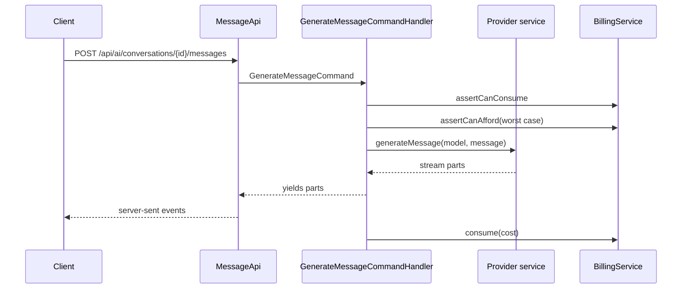

Everything AI-related goes through one indirection: ask the factory for a capability and a model, and get back a service that supports it. Providers are interchangeable, and a plugin can add more.

## Resolving a service

```php
use Ai\Domain\Completion\MessageServiceInterface;
use Ai\Domain\Services\AiServiceFactoryInterface;

$service = $this->factory->create(MessageServiceInterface::class, $model);
```

The factory walks its registered services, resolves each from the container, and returns the first that implements the requested interface and reports `supportsModel($model)`. If nothing matches, it throws.

Every service implements `Ai\Domain\Services\AiServiceInterface`:

```php
public function supportsModel(Model $model): bool;
public function getSupportedModels(): Traversable;
```

## Capabilities

| Interface | Method |
| --- | --- |
| `Completion\MessageServiceInterface` | `generateMessage()`, returns a `Generator` of stream parts |
| `Completion\TextCompletionServiceInterface` | `complete()`, a single instruction and input |
| `Image\ImageServiceInterface` | `generateImage()` |
| `Video\VideoServiceInterface` | `generateVideo()`, often asynchronous |
| `Speech\SpeechServiceInterface` | `getVoiceList()`, `generateSpeech()` |
| `Speech\VoiceCloningServiceInterface` | `cloneVoice()`, `deleteVoice()` |
| `Transcription\TranscriptionServiceInterface` | `generateTranscription()` |
| `Classification\ClassificationServiceInterface` | `generateClassification()` |
| `Embedding\EmbeddingServiceInterface` | `generateEmbedding()` |
| `IsolatedVoice\VoiceIsolatorServiceInterface` | `generateIsolatedVoice()` |

## Bundled providers

Registered during boot: OpenAI, Anthropic, Cohere, xAI, Google, Azure, ElevenLabs, Speechify, Stability AI, Clipdrop, fal.ai, WaveSpeed, Luma, Ollama, and a generic adapter for OpenAI-compatible servers. Each implements the capabilities its API supports.

Video and image generation is asynchronous at several providers. OpenAI, xAI, fal.ai and WaveSpeed call back to provider-specific webhook endpoints under `/webhooks/`, and WaveSpeed runs are also polled every minute by the `ai.poll_wavespeed_runs` task. Luma sends no callbacks, so its results are read only by the `ai.poll_luma_generations` task, which needs cron.

## The model registry

What users can select comes from the model registry, not from the services. Since 5.3 the registry lives in the database, and the release ships a catalog that is synced into it.

### Tables and entities

| Table | Entity | Holds |
| --- | --- | --- |
| `model_provider` | `Model\Domain\Entities\ProviderEntity` | A provider: its key, name, kind (`native`, `hub`, `server` or `integration`), origin, server URL, API key and settings |
| `model` | `Model\Domain\Entities\ModelEntity` | A model: its slug, type, name, origin, status, definition, labels, discount, markup, and preview media |
| `model_route` | `Model\Domain\Entities\RouteEntity` | One provider's way of serving a model: the id the provider's API knows it by (`route_key`), its status, request config and rates |
| `model_alias` | `Model\Domain\Entities\AliasEntity` | Older keys the model answers to, such as its 5.2 key |

A model can have several routes. One is active and serves every request; the others wait until an administrator makes them active. Every column is a value object or an enum from `Model\Domain\ValueObjects`, such as `Slug`, `Origin`, `ProviderKind`, `Rates` and `Markup`.

A model's **origin** says who maintains it:

| Origin | Admin label | Meaning |
| --- | --- | --- |
| `builtin` | Built-in | Shipped with the app and kept current by updates |
| `catalog` | Imported | From the bundled catalog, added by an administrator |
| `operator` | Custom | Created by an administrator or a plugin. Updates never touch it. |

### The bundled catalog

`config/registry/catalog.json` is the one catalog file, with the shape `{costs_checked, providers, models}`. Models are ranked by `rank` and name their provider in `service`. `Model\Infrastructure\Services\BundledCatalog` reads it in three parts:

| Method | Returns |
| --- | --- |
| `base()` | Native and hub providers, with their `default` models |
| `importable()` | The other models of those providers, offered under **Import models** |
| `servers()` | OpenAI-compatible servers and integrations with their models. A server is keyed by a UUID made from its URL. |

The catalog changes only with an app update. Installations don't fetch models or prices from anywhere else.

`Model\Infrastructure\Services\CatalogSynchronizer` applies a changed catalog once per change. It refreshes built-in models, adds new default models of native and hub providers switched off, switches off built-in models the catalog drops (they're kept, because library items still name them), and switches off once each imported model whose route the catalog no longer lists. Custom models are never touched.

<Note>
  Before 5.3 the registry was `config/registry/base.json` merged with an installation's `config/registry/registry.json`. On the first load after the update, `registry.json` is copied into the tables and then moved to `var/backups/registry.json`. Nothing reads it afterwards. It may hold custom-server API keys, so keep it somewhere safe or delete it.
</Note>

### Reading the registry

`Shared\Infrastructure\Services\ModelRegistry` still exposes the registry in its array shape, through `ArrayAccess` on `['directory']`: a list of providers, each with its `models`. Each model's `key` is its **slug**, and `route_key` is the id sent to the provider's API.

```php
use Shared\Infrastructure\Services\ModelRegistry;

foreach ($this->registry['directory'] as $provider) {
    foreach ($provider['models'] ?? [] as $model) {
        // $model['key'] (slug), $model['route_key'], $model['type'],
        // $model['name'], $model['enabled'], $model['rates']
    }
}
```

| Method | Purpose |
| --- | --- |
| `canonical(string $key): ?string` | The slug for any key a model goes by: its slug, an alias, or an id it `replaces`. Null when no model answers to it. |
| `ModelRegistry::formerKeys(array $directory): array` | Static. Every old key, mapped to the slug that answers to it now |
| `toArray()`, `getRegistry()` | The whole registry array |
| `save()` | Writes the edited `directory` back to the tables |
| `load()` | Reloads the registry from the store |
| `importable()`, `import(?array $ids = null)` | Catalog models the installation can import, and importing them |
| `importableServers()`, `importServers(?array $ids = null)` | The same for OpenAI-compatible servers |

The tables are read through `Model\Infrastructure\Services\RegistryStore`, which caches the directory under `registry.directory`. Until the tables exist, or if the database can't be read, the registry is read from the catalog file.

Models are known by slug everywhere: links, API responses, plans and history. Older keys keep working as lookups, and `ModelLinkMiddleware` redirects `?model=<old key>` to the slug. In Twig, the `model_key` filter returns the canonical slug of a key, or null.

## Chat generation



The handler returns a generator, and the request handler streams it. Parts are also folded into the stored message, so reloading the conversation shows the same content.

### Stream parts

| Part | Meaning |
| --- | --- |
| `TextDeltaPart` | The next chunk of the answer |
| `ReasoningDeltaPart`, `ReasoningSectionStartPart` | Reasoning output |
| `ToolStartPart`, `ToolArgsPart`, `ToolCallPart`, `ToolResultPart` | A tool being called and returning |
| `SourcePart` | A cited source |
| `LibraryItemPart` | Something generated and saved, such as an image |
| `UsagePart` | The running cost total |
| `ErrorPart` | Generation failed |
| `FinishPart` | The stream is done |

Only some of these are forwarded to the browser; the rest are internal. See the [REST API overview](/development/api/overview) for the client-visible events.

## Tools

Tools are what a model can call mid-answer: web search, page fetching, YouTube lookups, media generation, transcription, knowledge base and embedding search, memories and chat history, canvas documents, follow-up questions and voice selection.

They're held in a collection, and filtered per message: the tool must be enabled, allowed by the workspace's plan, and not disabled by the user. Temporary conversations exclude the tools that would leave state behind.

A tool returns its textual result plus its cost, which is added to the generation's total. See [AI tools](/development/plugins/guides/ai-tool).

## Embeddings and knowledge bases

Uploaded documents and links are chunked, embedded, and stored in a vector store. The default store keeps vectors as files in the configured storage; an alternative can be selected from the registered stores. Search is scoped by namespace and by the dataset units attached to the conversation. See [Vector stores](/development/plugins/guides/vector-store).

Documents are parsed by a reader stack that handles PDF, Word, HTML, XML, JSON, YAML, CSV and plain text.

## Credits

Usage becomes credits in `Ai\Infrastructure\Services\CostCalculator`, from the rates on each model. Administrators set those prices on the [Credit pricing](/billing/credit-pricing) page and on each model's **Pricing** tab; see [Models](/advanced/models).

### How a rate is priced

Each rate (`Model\Domain\ValueObjects\Rate`) has a key, a `RateType`, a unit, optional `conditions` on the request parameters, and its prices:

| Field | Meaning |
| --- | --- |
| `listedCost` | The provider's price in US dollars as the catalog lists it, with `costNote` and `costSource` |
| `cost` | The cost in use: the listed one, or the administrator's own (`costOwn`) |
| `ratio` | Fixed credits per unit. When set, it wins over the cost. |
| `typicalCost` | For hubs that bill each run in dollars, what a run typically costs. Display only. |

Credits per unit are `cost × markup × credits per USD`, where the markup is the model's own or the default (`pricing.markup`), and credits per USD is `pricing.credits_per_usd`. Fixed credits replace that result. The model's discount is applied after pricing. See [Configuration](/development/core/configuration#credit-pricing-and-model-registry-options) for the options.

### Usage and rate types

A service reports what a request used as a `Ai\Domain\ValueObjects\Usage`, line by line, in `Model\Domain\ValueObjects\RateType` units:

| `RateType` | Prices |
| --- | --- |
| `DEFAULT` | Whatever the model bills by when it bills by one thing: images, seconds, characters, pages |
| `INPUT`, `OUTPUT` | Input and output tokens |
| `CACHED_INPUT`, `CACHE_WRITE` | Prompt cache reads and writes. Priced as input when the model has no such rate. |
| `IMAGE` | Input images, or the image tokens of the input |

```php
use Ai\Domain\ValueObjects\Usage;
use Model\Domain\ValueObjects\RateType;

Usage::tokens($input, $output, cachedInput: $cached);  // a chat turn
Usage::units(5);                                        // five of whatever the model bills by
Usage::of(RateType::IMAGE, 2)->add(RateType::OUTPUT, 900);
Usage::none();
```

`Usage` is immutable: `add()` returns a new instance, and `lines()` returns the `[RateType, quantity]` pairs.

### CostCalculator

```php
public function cost(string|Model $model, Usage $usage, array $params = []): CreditCount;
public function estimate(string|Model $model, array $params = [], RateType $type = RateType::DEFAULT, bool $discounted = true): CreditCount;
public function discount(string|Model $model): float;  // percent
public function rate(string|Model $model, RateType $type, array $params = []): ?Rate;
```

Each usage line is priced at the model's rate of the same type whose `conditions` the request parameters meet, the most specific first. A type with no rate falls back to input for cached input, then to a rate keyed as the model, then to the dearest plain-unit rate. `estimate()` takes the quantity from the request where it says (a video's duration, a number of images), otherwise from the model's typical quantity in the registry (`multiplier`), otherwise one unit. Pass `discounted: false` for the price before the discount, which the UI shows struck through.

<Warning>
  The 5.2 signatures are gone: `calculate(float|int $amount, string|Model $model, ?int $opt)`, `estimate($model, ?int $opt)` and the bitmask constants `INPUT`, `OUTPUT`, `IMAGE`, `QUALITY_SD`, `QUALITY_HD` and `SIZE_*`. Report usage with `Usage` and `RateType` instead.
</Warning>

### The billing lifecycle

<Steps>
  <Step title="Check">
    `BillingService::assertCanConsume()` refuses a workspace that is out of credits or past its usage window.
  </Step>
  <Step title="Check the worst case">
    For chat, `BillingService::assertCanAfford(WorkspaceEntity $workspace, CreditCount $worstCase, ?Model $model = null)` prices the worst case through `CostCalculator`: the prompt and history at about four characters a token, plus a 4,096-token reply. If the workspace can't cover it, it throws `Ai\Domain\Exceptions\InsufficientBalanceForRequestException`, which extends `InsufficientCreditsException`. It's skipped when negative balances are allowed, when the worst case is zero (an unpriced model), when the workspace isn't charged (BYOK), and on unlimited plans. Past the session cap, only add-on credits count.
  </Step>
  <Step title="Reserve">
    For image, video and other generations, `BillingService::reserve()` holds the estimate so concurrent work can't overspend.
  </Step>
  <Step title="Generate">
    The provider call runs.
  </Step>
  <Step title="Release and consume">
    The reservation is released, and the real cost is consumed, which dispatches a credit usage event.
  </Step>
</Steps>

When a workspace brings its own provider key, the billing service skips deduction, which is why the model is always passed alongside the workspace.

## Related

- [Billing subsystem](/development/core/billing-subsystem)
- [AI providers guide](/development/plugins/guides/ai-provider)
- [AI models and credits](/development/plugins/ai-models-and-credits)
- [Unified credit system](/billing/unified-credit-system)
