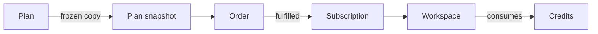
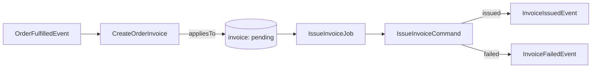

Billing ties together what a customer bought, what their workspace may do, and how much of it they've used.

## The model

| Entity | Role |
| --- | --- |
| `PlanEntity` | What's for sale: price, cycle, credits, capabilities, features |
| `PlanSnapshotEntity` | A frozen copy taken when someone buys, so later plan edits don't rewrite history |
| `OrderEntity` | One purchase: currency, totals, tax, coupon, gateway, status |
| `SubscriptionEntity` | Ongoing access: usage, renewal dates, the provider's reference |
| `CouponEntity` | A discount, optionally limited to a number of cycles |
| `InvoiceEntity` | The invoice of a paid order in an external invoicing service |

## Enumerations

| Enum | Values |
| --- | --- |
| `BillingCycle` | `one-time`, `monthly`, `yearly`, `lifetime` |
| `OrderStatus` | `draft`, `pending`, `failed`, `processing`, `completed`, `cancelled` |
| `SubscriptionStatus` | `active`, `trialing`, `canceled`, `ended`, `unknown` |

`BillingCycle` also answers two questions the rest of the system asks: whether the cycle recurs, and whether it renews.

## What a plan grants

`PlanConfig` is the capability side of a plan: per-feature settings for chat, writer, imagine, video, transcription, voice-over, voice isolation and classification, plus allowed models, tool switches, allowed assistants and templates, and an `extensions` map plugins can add to.

Because a snapshot carries the config, a subscription keeps the capabilities it was sold with. See [Plan config extensions](/development/plugins/guides/plan-config-extension).

## Credits

Credits live on the workspace, in three places:

| Field | Meaning |
| --- | --- |
| Subscription credits | Granted by the plan, reset each period |
| Add-on credits | Bought separately, or granted by a one-time plan |
| Session credits | Used in session billing mode |

A `null` credit count means unlimited. Deduction takes from the subscription first, then the add-on balance.

`BillingService` is the gate everything goes through:

| Method | Purpose |
| --- | --- |
| `assertCanConsume()` | Throws when the workspace can't spend right now |
| `reserve()` | Holds an estimate for the duration of a call |
| `release()` | Returns a held estimate |
| `consume()` | Charges the real cost and dispatches a credit usage event |

Relevant options: `option.billing.usage_mode`, which is either unpaced or session-based, and `option.billing.negative_balance_enabled`.

## Purchase flow

<Steps>
  <Step title="Order">
    Creating an order snapshots the plan, applies a coupon, and asks the configured tax engine for tax lines.
  </Step>
  <Step title="Payment">
    The selected gateway starts the payment, and the user is redirected or shown an embedded form.
  </Step>
  <Step title="Confirmation">
    On return, the gateway verifies the payment and hands back a provider reference. The order is paid.
  </Step>
  <Step title="Fulfilment">
    For a recurring plan, a subscription is created from the order, carrying the reference and the gateway. For a one-time plan, credits are added to the workspace. Any previous subscription is cancelled.
  </Step>
  <Step title="Invoice and purchase email">
    If the order is invoiced, an invoice is recorded and issued in the background. The customer's purchase confirmation email is sent from a queued job, with the invoice PDF attached when there is one. See [Invoicing](#invoicing).
  </Step>
</Steps>

The full sequence, including webhooks, is in [Payment gateways](/development/plugins/guides/payments/overview).

## Renewals

The **Renew subscriptions** scheduled task (`billing.renew_subscriptions`) runs every minute and renews up to 200 subscriptions whose renewal date has passed, looked up by that date. More than that are worked through over the following minutes. Renewal resets usage, settles any credit debt, and moves the next reset 30 days out, then dispatches a usage reset event.

<Warning>
  Renewal resets usage; it doesn't charge anyone. Either the provider bills on its own schedule, or a gateway plugin charges when the usage reset event fires.
</Warning>

Cancelling sets the subscription to end at its next renewal date and asks the gateway to cancel at the provider. The **End expired subscriptions** scheduled task (`billing.end_expired_subscriptions`) runs every minute and ends those whose cancellation date has passed, moving the workspace to the plan configured as `option.billing.fallback_plan`.

Both tasks save each subscription on its own. One that fails is logged, its unsaved changes are discarded, and it comes round again the next minute. See [Background jobs and cron](/development/core/background-jobs-and-cron) for how scheduled tasks run.

## Payment gateways

Gateways are registered in a factory, keyed by a lookup key, and implement a small interface for purchase, completion, cancellation and webhooks. Marker interfaces describe how the gateway is presented and whether it supports a given plan. Aikeedo ships Stripe, PayPal, bank transfer and manual payment.

## Tax

A tax engine calculates lines when an order is created, and the result is stored on the order, so gateways charge the taxed total without extra work. The selected engine comes from `option.billing.tax_engine`, falling back to a no-op engine. See [Tax engines](/development/plugins/guides/tax-engine).

## Invoicing

An invoicing engine issues invoices for paid orders in an external service. The selected engine comes from `option.billing.invoicing.engine`. The default, `none` (**No invoicing**), turns invoicing off, and so does an engine whose plugin is no longer installed.

The `CreateOrderInvoice` listener runs on `OrderFulfilledEvent`. When invoicing is on, the order's total is above zero, and the engine's `appliesTo()` accepts the order, it records a row in the `invoice` table and queues an `IssueInvoiceJob`. It never calls the service itself, so fulfilment never waits on it, and a failure here is logged rather than thrown.

Each invoice has one of three statuses:

| Status | Meaning |
| --- | --- |
| `pending` | Waiting for its first attempt |
| `issued` | Created and approved in the service. The external id and invoice number are stored. |
| `failed` | The last attempt failed. It's tried again while a next attempt is scheduled. |

`IssueInvoiceCommand` makes one attempt and records the outcome on the invoice instead of throwing. After a failure, the next attempt waits 5 minutes, then 15 minutes, 1 hour, 3 hours, 12 hours, and 24 hours for each attempt after that. Retries stop after 8 attempts, or at once when the engine throws a non-retryable `InvoicingException`. The **Retry invoices** scheduled task (`billing.retry_invoices`) runs every minute and queues a job for each invoice that is due.

An administrator can act on an order from its page in the admin panel. **Retry now** dispatches `RetryOrderInvoiceCommand`, which tries at once rather than queueing. On a fulfilled, paid order with no invoice, the same button reads **Create invoice**, and it creates the invoice even when the engine's `appliesTo()` skipped the order.

The PDF is never stored. Each download, at `/app/billing/orders/{id}/invoice` for the customer and `/admin/orders/{id}/invoice` for administrators, fetches it from the engine. See [Invoicing engines](/development/plugins/guides/invoicing-engine).

### Purchase confirmation emails

The `SendPurchaseConfirmation` listener decides when the customer hears about a purchase. Every message is sent from a queued `SendPurchaseConfirmationJob`, because attaching an invoice means fetching its PDF from the service:

- **A paid order that isn't invoiced** is confirmed as soon as it's fulfilled.
- **An invoiced order** waits for its invoice, so the PDF can be attached. It's confirmed when the invoice is issued, or without the PDF when issuing stops for good.
- **An invoice that takes longer than 60 minutes** is given up on for the confirmation. The **Send delayed purchase confirmations** scheduled task (`billing.purchase_confirmations`) runs every 5 minutes and sends those confirmations without the PDF.
- **An invoice issued after its confirmation went out** follows in an **Invoice ready** email of its own.
- **Free orders** get no purchase confirmation.

Both emails can be turned off under **Settings → Email → Emails**. See [Email](/development/core/email).

## Currency

Plans are priced in the platform currency. When a gateway bills in another one, a helper converts through the configured rate provider, and silently falls back to the original amount if conversion fails. See [Currency rate providers](/development/plugins/guides/currency-rate-provider).

The selected provider, `option.currency.provider`, is always wrapped in `CustomRateProvider` before it's bound to `RateProviderInterface`. Administrators can set custom rates under **Settings → Exchange → Custom rates**, stored in `option.currency.rates` as units of each currency per 1 USD, and they always win over the provider's rates. Without a provider, only USD and the currencies with a custom rate convert; any other currency is treated as equal to USD, and MRR reports an error rather than a wrong figure.

## Commands

| Command | Purpose |
| --- | --- |
| `CreateOrderCommand` | Start a purchase, including snapshot, coupon and tax |
| `PayOrderCommand` | Record payment with a gateway reference |
| `FulfillOrderCommand` | Grant the plan or credits |
| `CancelSubscriptionCommand` | End at period end, and tell the gateway |
| `EndSubscriptionCommand` | End now, and apply the fallback plan |
| `RenewSubscriptionCommand` | Reset usage for a due subscription |
| `ReadSubscriptionCommand::createByExternalId()` | Find a subscription from a webhook |
| `IssueInvoiceCommand` | Make one attempt at issuing an invoice, and record the outcome |
| `RetryOrderInvoiceCommand` | Issue an order's invoice now, creating it first if the order has none |

## Related

- [Payment gateways](/development/plugins/guides/payments/overview)
- [Invoicing engines](/development/plugins/guides/invoicing-engine)
- [AI subsystem](/development/core/ai-subsystem)
- [Plans, snapshots and subscriptions](/billing/plans-snapshots-subscriptions)
- [Unified credit system](/billing/unified-credit-system)
