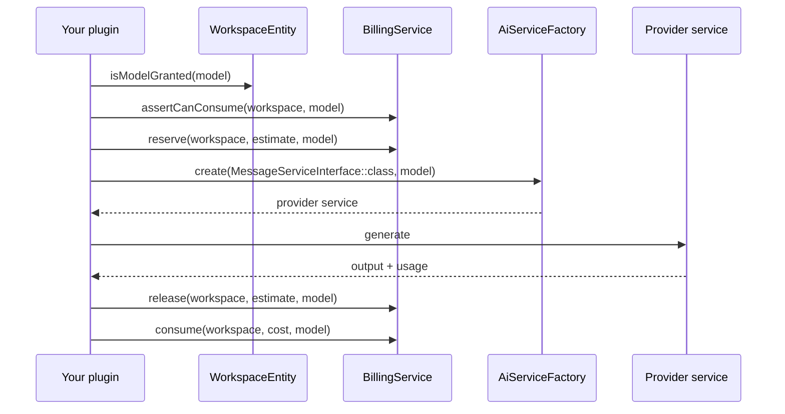

A plugin can use the AI services the installation already has configured, instead of holding its own API keys. Aikeedo resolves a service for the model, and the billing service handles credits.

## The flow



Reserving before the call stops a workspace from starting more work than its balance allows, then you release the estimate and consume the real cost once you know it.

## Check access first

```php
use Ai\Domain\Exceptions\ModelNotAccessibleException;
use Ai\Domain\ValueObjects\Model;

$model = new Model('acme-large'); // a model's slug

if (!$workspace->isModelGranted($model)) {
    throw new ModelNotAccessibleException($model->value);
}

// Throws when the workspace is out of credits or past its usage window.
$this->billing->assertCanConsume($workspace, $model);
```

`isModelGranted()` reflects the workspace's plan. `assertCanConsume()` throws `Ai\Domain\Exceptions\InsufficientCreditsException` or `Billing\Domain\Exceptions\UsageLimitException`, which the exception middleware turns into a `403`.

## Resolve a service

```php
use Ai\Domain\Completion\TextCompletionServiceInterface;
use Ai\Domain\Services\AiServiceFactoryInterface;

public function __construct(
    private AiServiceFactoryInterface $factory,
) {}

$service = $this->factory->create(TextCompletionServiceInterface::class, $model);

$response = $service->complete(
    $model,
    'You summarize notes in one sentence.',
    $noteBody,
    maxTokens: 256,
);
```

The factory returns the first registered service that implements the interface and supports the model, and throws when nothing matches.

| Capability interface | Use for |
| --- | --- |
| `Ai\Domain\Completion\TextCompletionServiceInterface` | A single prompt-and-answer completion |
| `Ai\Domain\Completion\MessageServiceInterface` | Streamed chat, returns a `Generator` of stream parts |
| `Ai\Domain\Image\ImageServiceInterface` | Image generation |
| `Ai\Domain\Video\VideoServiceInterface` | Video generation |
| `Ai\Domain\Speech\SpeechServiceInterface` | Text to speech |
| `Ai\Domain\Transcription\TranscriptionServiceInterface` | Speech to text |
| `Ai\Domain\Classification\ClassificationServiceInterface` | Classification |
| `Ai\Domain\Embedding\EmbeddingServiceInterface` | Embeddings |
| `Ai\Domain\IsolatedVoice\VoiceIsolatorServiceInterface` | Voice isolation |

## Bill the usage

```php
use Ai\Infrastructure\Services\CostCalculator;
use Billing\Domain\Services\BillingService;

public function __construct(
    private CostCalculator $calculator,
    private BillingService $billing,
) {}

$estimate = $this->calculator->estimate($model, $params);

$this->billing->reserve($workspace, $estimate, $model);

try {
    $response = $service->complete($model, $instructions, $input);
} finally {
    // Always give the reservation back, then charge what it really cost.
    $this->billing->release($workspace, $estimate, $model);
}

$this->billing->consume($workspace, $response->cost, $model);
```

Most service responses carry the cost the provider service already calculated, such as `TextCompletionResponse::$cost`, so you rarely compute it yourself.

| Method | Effect |
| --- | --- |
| `assertCanConsume(WorkspaceEntity, ?Model)` | Throws if the workspace can't spend right now |
| `assertCanAfford(WorkspaceEntity, CreditCount $worstCase, ?Model)` | Throws `Ai\Domain\Exceptions\InsufficientBalanceForRequestException` if the available credits can't cover the worst-case cost |
| `reserve(WorkspaceEntity, CreditCount, ?Model)` | Holds an estimated amount for the duration of the call |
| `release(WorkspaceEntity, CreditCount, ?Model)` | Returns the held amount |
| `consume(WorkspaceEntity, CreditCount, ?Model)` | Charges the real cost and dispatches `CreditUsageEvent` |

<Note>
  Always pass the `Model`. The billing service uses it to decide whether credits apply at all: when the workspace brings its own provider key, nothing is charged.
</Note>

### Check the worst case for open-ended work

Text is billed after the provider answers, and a balance that can't cover the bill is cut to zero rather than taken below it. For work whose cost you only know afterwards, price the worst case first, the way the core does for chat:

```php
use Ai\Domain\ValueObjects\Usage;

$worstCase = $this->calculator->cost(
    $model,
    Usage::tokens(intdiv(mb_strlen($prompt), 4), 4096)
);

$this->billing->assertCanAfford($workspace, $worstCase, $model);
```

It returns without checking when negative balances are allowed, when the worst case is zero (the model has no price), when the workspace isn't charged, and on unlimited plans. `InsufficientBalanceForRequestException` extends `InsufficientCreditsException`, so the exception middleware turns it into a `403`.

### Cost calculation

Use the calculator when you bill something the core doesn't price for you. Describe what the request used as a `Usage`, in the `RateType` units the model's rates are declared in, and `cost()` prices each line at the matching rate:

```php
use Ai\Domain\ValueObjects\Usage;
use Model\Domain\ValueObjects\RateType;

// A chat turn
$cost = $this->calculator->cost($model, Usage::tokens($inputTokens, $outputTokens));

// Two images at a requested resolution; rates with conditions match $params
$cost = $this->calculator->cost($model, Usage::units(2), ['resolution' => '2k']);

// Mixed usage
$cost = $this->calculator->cost(
    $model,
    Usage::of(RateType::IMAGE, $inputImages)->add(RateType::OUTPUT, $outputTokens)
);
```

| Method | Returns |
| --- | --- |
| `cost(string\|Model $model, Usage $usage, array $params = []): CreditCount` | Credits for what a request used, after the model's discount |
| `estimate(string\|Model $model, array $params = [], RateType $type = RateType::DEFAULT, bool $discounted = true): CreditCount` | The expected cost before a request runs, for reserving and for display |
| `discount(string\|Model $model): float` | The model's discount, in percent |
| `rate(string\|Model $model, RateType $type, array $params = []): ?Rate` | The rate a line of that type is priced at |

The credits come from the prices administrators set: the provider cost times the markup times credits per US dollar, or fixed credits. A model with no price costs nothing. See [Credit pricing](/billing/credit-pricing).

<Warning>
  `CostCalculator::calculate()` and the bitmask constants (`INPUT`, `OUTPUT`, `IMAGE`, `QUALITY_HD`, `SIZE_*`) were removed in 5.3. Replace `calculate($tokens, $model, CostCalculator::INPUT)` with `cost($model, Usage::of(RateType::INPUT, $tokens))`.
</Warning>

## Streaming chat

`MessageServiceInterface::generateMessage()` returns a generator of stream parts. Fold them as they arrive, and take the cost from the usage part:

```php
use Ai\Domain\ValueObjects\Stream\TextDeltaPart;
use Ai\Domain\ValueObjects\Stream\UsagePart;
use Billing\Domain\ValueObjects\CreditCount;

$cost = new CreditCount(0);
$text = '';

foreach ($service->generateMessage($model, $message) as $part) {
    if ($part instanceof TextDeltaPart) {
        $text .= $part->delta;
    }

    if ($part instanceof UsagePart) {
        // Each usage part carries the running total, so overwrite it.
        $cost = $part->cost;
    }
}

$this->billing->consume($workspace, $cost, $model);
```

To forward that stream to a browser, see [Streaming responses](/development/plugins/streaming-responses).

## Which models exist

The model registry holds every provider and model the installation knows about, including the administrator's own. Since 5.3 it lives in the database, and `ModelRegistry` exposes it in the same array shape:

```php
use Shared\Infrastructure\Services\ModelRegistry;

public function __construct(
    private ModelRegistry $registry,
) {}

foreach ($this->registry['directory'] as $provider) {
    foreach ($provider['models'] ?? [] as $model) {
        // $model['key'] is the slug, $model['route_key'] the provider's id,
        // plus $model['name'], $model['type'] and $model['enabled']
    }
}
```

Models are known by their slug. To store a model a user or administrator picked, store its slug, and normalize keys from older data with `canonical()`:

```php
$slug = $this->registry->canonical($savedKey); // null when no model answers to it
```

Let administrators pick a model in your settings page rather than hardcoding one, and fall back to a related global setting, such as `option.embeddings.model`, where one exists.

## Adding your own provider

Everything above consumes services the core registered. To add a provider, implement a capability interface and register it with the factory. See [AI providers](/development/plugins/guides/ai-provider).

## Related

- [Streaming responses](/development/plugins/streaming-responses)
- [AI providers guide](/development/plugins/guides/ai-provider)
- [AI subsystem internals](/development/core/ai-subsystem)
- [Unified credit system](/billing/unified-credit-system)
