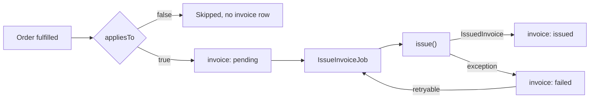

An invoicing engine creates the invoice for a paid order in an external service, such as an accounting or e-invoicing system, and fetches it back as a PDF when someone downloads it. Aikeedo ships a null engine, **No invoicing**, and administrators select an engine under **Settings → Billing → Invoicing**.

## When it runs

An order is invoiced when all of these are true:

- An engine other than **No invoicing** is selected, and its plugin is installed.
- The order is fulfilled, and its total is above zero. Free orders are never invoiced.
- The engine's `appliesTo()` returns `true` for the order.

When the order is fulfilled, Aikeedo records a row in the `invoice` table with the status `pending` and queues an `IssueInvoiceJob`. The job calls your engine's `issue()` in the background, so a slow or failing service never holds up the payment callback that fulfilled the order.



Aikeedo keeps the external id and the invoice number your engine returns, never the document itself. Each time a customer or administrator downloads the invoice, Aikeedo calls `fetchPdf()` and streams the result, because invoices carry customer details and stored files can be served publicly from a CDN.

## The interface

```php
namespace Billing\Infrastructure\Invoicing;

interface InvoicingEngineInterface
{
    public function getLookupKey(): string;
    public function getName(): string;
    public function appliesTo(OrderEntity $order): bool;
    public function issue(OrderEntity $order): IssuedInvoice;
    public function fetchPdf(InvoiceEntity $invoice): InvoicePdf;
}
```

| Method | Purpose |
| --- | --- |
| `getLookupKey()` | A stable key. It's stored in `option.billing.invoicing.engine` and on every invoice row. |
| `getName()` | Shown in the engine select and on the Invoicing engines page |
| `appliesTo()` | Whether the engine invoices this order on its own. Called only for fulfilled, paid orders. |
| `issue()` | Creates the invoice in the service, records the payment on it, approves it, and returns its id and number |
| `fetchPdf()` | Returns the invoice as the service prints it |

The value objects you return:

```php
use Billing\Domain\ValueObjects\ExternalId;
use Billing\Domain\ValueObjects\InvoiceNumber;
use Billing\Infrastructure\Invoicing\InvoicePdf;
use Billing\Infrastructure\Invoicing\IssuedInvoice;

new IssuedInvoice(
    externalId: new ExternalId('inv_8f2c1a'),   // the service's id, used to fetch it again
    number: new InvoiceNumber('INV-2026-0042'), // printed on the invoice, shown to customers
);

new InvoicePdf(
    content: $bytes,                     // the PDF file contents
    filename: 'invoice-INV-2026-0042.pdf',
);
```

The invoice number comes from your engine, not from Aikeedo. It's shown on the order page, in the admin panel and in the purchase emails.

When something goes wrong, throw `Billing\Infrastructure\Invoicing\InvoicingException`:

```php
throw new InvoicingException(
    'Acme Ledger rejected the API key. Check it in the engine settings.',
    retryable: false,
);
```

The message is shown to administrators on the order, so write it in their terms. Set `retryable` to `false` when trying again can't help until someone changes something, such as wrong credentials or a missing setting. Any other exception is recorded with its message and treated as retryable.

## Implementation

This engine sends invoices to a fictional service, Acme Ledger. It's split in two: a client that talks to the API and translates its errors into `InvoicingException`, and the engine that maps an order onto an invoice.

```php src/Client.php
<?php

declare(strict_types=1);

namespace Acme\Invoicing;

use Billing\Infrastructure\Invoicing\InvoicingException;
use Easy\Container\Attributes\Inject;
use Psr\Http\Client\ClientExceptionInterface;
use Psr\Http\Client\ClientInterface;
use Psr\Http\Message\RequestFactoryInterface;
use Psr\Http\Message\StreamFactoryInterface;

class Client
{
    private const BASE_URL = 'https://api.acme-ledger.test/v1';

    public function __construct(
        private ClientInterface $client,
        private RequestFactoryInterface $requestFactory,
        private StreamFactoryInterface $streamFactory,

        #[Inject('option.acme_ledger.api_key')]
        private ?string $apiKey = null,
    ) {}

    public function findInvoice(string $reference): ?object
    {
        $result = json_decode($this->request(
            'GET',
            '/invoices?reference=' . rawurlencode($reference)
        ));

        return $result->data[0] ?? null;
    }

    /** @param array<string,mixed> $payload */
    public function createInvoice(array $payload): object
    {
        return json_decode($this->request('POST', '/invoices', $payload));
    }

    public function approveInvoice(string $id): object
    {
        return json_decode($this->request('POST', "/invoices/{$id}/approve", []));
    }

    public function downloadPdf(string $id): string
    {
        return $this->request('GET', "/invoices/{$id}/pdf", accept: 'application/pdf');
    }

    /**
     * @param array<string,mixed>|null $payload
     * @throws InvoicingException
     */
    private function request(
        string $method,
        string $path,
        ?array $payload = null,
        string $accept = 'application/json',
    ): string {
        if (!$this->apiKey) {
            throw new InvoicingException(
                'Acme Ledger is not connected. Add the API key in its settings.',
                retryable: false,
            );
        }

        $request = $this->requestFactory
            ->createRequest($method, self::BASE_URL . $path)
            ->withHeader('Authorization', 'Bearer ' . $this->apiKey)
            ->withHeader('Accept', $accept);

        if ($payload !== null) {
            $request = $request
                ->withHeader('Content-Type', 'application/json')
                ->withBody($this->streamFactory->createStream(
                    safe_json_encode($payload)
                ));
        }

        try {
            $response = $this->client->sendRequest($request);
        } catch (ClientExceptionInterface $th) {
            // Network trouble passes: try again later.
            throw new InvoicingException(
                'Acme Ledger could not be reached.',
                previous: $th,
            );
        }

        $status = $response->getStatusCode();

        if ($status === 401 || $status === 403) {
            throw new InvoicingException(
                'Acme Ledger rejected the API key. Check it in the engine settings.',
                retryable: false,
            );
        }

        if ($status === 422) {
            // The service refused the data. Retrying sends the same data.
            $error = json_decode((string) $response->getBody());

            throw new InvoicingException(
                'Acme Ledger refused the invoice: ' . ($error->message ?? 'invalid data'),
                retryable: false,
            );
        }

        if ($status >= 300) {
            // Rate limits and outages: worth another attempt.
            throw new InvoicingException(
                sprintf('Acme Ledger returned HTTP %d.', $status)
            );
        }

        return (string) $response->getBody();
    }
}
```

```php src/AcmeLedgerEngine.php
<?php

declare(strict_types=1);

namespace Acme\Invoicing;

use Billing\Domain\Entities\InvoiceEntity;
use Billing\Domain\Entities\OrderEntity;
use Billing\Domain\ValueObjects\ExternalId;
use Billing\Domain\ValueObjects\InvoiceNumber;
use Billing\Domain\ValueObjects\TaxLine;
use Billing\Infrastructure\Invoicing\InvoicePdf;
use Billing\Infrastructure\Invoicing\InvoicingEngineInterface;
use Billing\Infrastructure\Invoicing\InvoicingException;
use Billing\Infrastructure\Invoicing\IssuedInvoice;
use Easy\Container\Attributes\Inject;
use Override;

class AcmeLedgerEngine implements InvoicingEngineInterface
{
    public const LOOKUP_KEY = 'acme-ledger';

    public function __construct(
        private Client $client,

        /** @var list<string>|null Payment gateway keys to invoice */
        #[Inject('option.acme_ledger.gateways')]
        private ?array $gateways = null,
    ) {}

    #[Override]
    public function getLookupKey(): string
    {
        return self::LOOKUP_KEY;
    }

    #[Override]
    public function getName(): string
    {
        return 'Acme Ledger';
    }

    #[Override]
    public function appliesTo(OrderEntity $order): bool
    {
        // Only the payment methods the admin picked on the settings page.
        $gateway = $order->getPaymentGateway()->value;

        return $gateway !== null
            && in_array($gateway, $this->gateways ?? [], true);
    }

    #[Override]
    public function issue(OrderEntity $order): IssuedInvoice
    {
        $reference = $order->getId()->getValue()->toString();

        // An earlier attempt may have created the invoice before it failed,
        // so look it up before creating another.
        $invoice = $this->client->findInvoice($reference)
            ?? $this->client->createInvoice($this->payload($order, $reference));

        if ($invoice->status === 'draft') {
            $invoice = $this->client->approveInvoice($invoice->id);
        }

        return new IssuedInvoice(
            new ExternalId($invoice->id),
            new InvoiceNumber($invoice->number),
        );
    }

    #[Override]
    public function fetchPdf(InvoiceEntity $invoice): InvoicePdf
    {
        $id = $invoice->getExternalId()->value;

        if (!$id) {
            throw new InvoicingException('The invoice has no Acme Ledger id.', false);
        }

        return new InvoicePdf(
            $this->client->downloadPdf($id),
            sprintf('invoice-%s.pdf', $invoice->getNumber()->value ?? $id),
        );
    }

    /** @return array<string,mixed> */
    private function payload(OrderEntity $order, string $reference): array
    {
        $workspace = $order->getWorkspace();
        $owner = $workspace->getOwner();
        $address = $workspace->getAddress();

        $name = $address?->isBusiness && $address->companyName
            ? $address->companyName
            : trim($owner->getFirstName()->value . ' ' . $owner->getLastName()->value);

        // Amounts are in minor units, as Aikeedo stores them.
        return [
            'reference' => $reference,
            'currency' => $order->getCurrencyCode()->value,
            'customer' => [
                'name' => $name,
                'email' => $owner->getEmail()->value,
                'is_business' => $address?->isBusiness ?? false,
                'tax_id' => $address?->taxId,
                'country' => $address?->country,
                'city' => $address?->city,
                'line1' => $address?->line1,
                'zip' => $address?->zip,
            ],
            'lines' => [[
                'description' => $order->getPlan()->getTitle()->value,
                'amount' => $order->getSubtotal()->value,
            ]],
            'discount' => $order->getDiscount()->value,
            'taxes' => array_map(
                fn(TaxLine $line) => [
                    'name' => $line->name,
                    'amount' => $line->amount->value,
                ],
                $order->getTaxLines()
            ),
            'payment' => [
                'amount' => $order->getTotalPrice()->value,
                'method' => $order->getPaymentGateway()->value,
                'reference' => $order->getExternalId()->value,
            ],
        ];
    }
}
```

### Rules to follow

- **Make `issue()` safe to call twice.** An attempt can create the invoice and then fail, for example on approval or on a timeout. The next attempt calls `issue()` again for the same order, so look the invoice up by a reference you control, such as the order id, before creating one.
- **Expect orders `appliesTo()` would skip.** An administrator can create an invoice by hand for any fulfilled, paid order, from the order page in the admin panel. `issue()` is then called even when `appliesTo()` returns `false`, so don't rely on `appliesTo()` having filtered the order.
- **Choose `retryable` deliberately.** A non-retryable failure stops the retries at once and waits for an administrator. Use it for problems that need someone to change a setting, and let outages and rate limits retry.
- **Write messages for administrators.** "Check the API keys" helps. A raw response body doesn't.
- **Return quickly.** The job that calls `issue()` has a 120-second timeout. When an administrator clicks **Create invoice** or **Retry now**, `issue()` runs inside that request.
- **Don't cache the PDF yourself.** `fetchPdf()` is called on every download by design.
- **Work in minor units.** Order amounts, tax amounts and discounts are integers in the currency's smallest unit.

## Retries and failures

A failed attempt sets the invoice to `failed`, stores the message, and schedules the next attempt with a growing delay:

| After attempt | Next attempt in |
| --- | --- |
| 1 | 5 minutes |
| 2 | 15 minutes |
| 3 | 1 hour |
| 4 | 3 hours |
| 5 | 12 hours |
| 6 and 7 | 24 hours |

After the eighth attempt, or straight away when your engine throws a non-retryable `InvoicingException`, no further attempt is scheduled. The invoice stays `failed` until an administrator clicks **Retry now** on the order page.

The **Retry invoices** scheduled task (`billing.retry_invoices`) runs every minute and queues an `IssueInvoiceJob` for each invoice that is due, up to 50 per run. It also picks up an invoice whose first job was never run.

If the engine an invoice was created with is no longer available, for example because its plugin is switched off, the attempt fails as retryable. Invoices keep the engine they were created with, so switching engines doesn't move existing invoices to the new one.

## Register it

```php src/Plugin.php
use Billing\Infrastructure\Invoicing\InvoicingEngineInterface;
use Shared\Infrastructure\Collections\ServiceCollectionInterface;

public function __construct(
    private ServiceCollectionInterface $services,
    private FilesystemLoader $loader,
    private AttributeMapper $mapper,
) {}

public function boot(Context $context): void
{
    $this->loader->addPath(__DIR__ . '/../templates', 'acme-ledger');
    $this->mapper->addPath(__DIR__);

    $this->services->add(
        AcmeLedgerEngine::LOOKUP_KEY,
        AcmeLedgerEngine::class,
        InvoicingEngineInterface::class
    );
}
```

The engine appears in the **Invoicing engine** select under **Settings → Billing → Invoicing**, where an administrator selects it. The selected key is stored in `option.billing.invoicing.engine`. Every installed engine is also listed under **Settings → Finance → Invoicing engines**.

## The settings page

Both the **Configure selected engine** link on the billing page and the Invoicing engines list point to `/admin/settings/invoicing-engines/{key}`, so declare that route:

```php
use Billing\Infrastructure\Payments\PaymentGatewayFactoryInterface;

#[Route(path: '/settings/invoicing-engines/acme-ledger', method: RequestMethod::GET)]
class SettingsRequestHandler extends AbstractAdminViewRequestHandler implements
    RequestHandlerInterface
{
    public function __construct(
        private PaymentGatewayFactoryInterface $gateways,
    ) {}

    public function handle(ServerRequestInterface $request): ResponseInterface
    {
        return new ViewResponse('@acme-ledger/settings.twig', [
            'gateways' => $this->gateways,
        ]);
    }
}
```

The gateway factory iterates as key and gateway pairs, so the template can offer a checkbox per payment method and save the chosen keys to `acme_ledger.gateways`. Set `extra.default_url` to the same path. For the form itself, see [Admin settings pages](/development/plugins/admin-settings-pages).

<Tip>
  Let administrators choose which payment methods are invoiced. Orders paid by bank transfer or entered by hand often need a different treatment from card payments, and your `appliesTo()` is the place to decide.
</Tip>

## What customers see

Once the invoice is issued, customers can download it from the order page in their billing area, and administrators from the order in the admin panel. Both downloads call `fetchPdf()`.

The purchase confirmation email waits for the invoice so it can attach the PDF. If the invoice isn't issued within 60 minutes, or issuing stops for good, the confirmation goes out without it, and an **Invoice ready** email follows when the invoice is issued. See [Billing internals](/development/core/billing-subsystem#invoicing) for the full sequence.

## Reacting to invoices

Core dispatches two events you can listen to, both carrying `$event->invoice`:

| Event | Fires when |
| --- | --- |
| `Billing\Domain\Events\InvoiceIssuedEvent` | An invoice is created and approved in the service |
| `Billing\Domain\Events\InvoiceFailedEvent` | An attempt fails. `$event->isFinal` is `true` when no further attempt is scheduled. |

Listen to `InvoiceFailedEvent` with `isFinal` set to alert someone when an invoice needs attention. See [Events](/development/core/events).

## Testing

<div className="flex flex-col gap-2">
  <div className="flex gap-2 items-start"><span className="flex h-[1lh] shrink-0 items-center"><Icon icon="square-rounded-check" size="18" /></span><span>A paid order for an invoiced payment method gets an invoice, and its number shows on the order.</span></div>
  <div className="flex gap-2 items-start"><span className="flex h-[1lh] shrink-0 items-center"><Icon icon="square-rounded-check" size="18" /></span><span>A free order, or one for a payment method you don't invoice, gets no invoice row.</span></div>
  <div className="flex gap-2 items-start"><span className="flex h-[1lh] shrink-0 items-center"><Icon icon="square-rounded-check" size="18" /></span><span><strong>Create invoice</strong> works on an order your engine skipped.</span></div>
  <div className="flex gap-2 items-start"><span className="flex h-[1lh] shrink-0 items-center"><Icon icon="square-rounded-check" size="18" /></span><span>Calling <code>issue()</code> twice for the same order leaves one invoice in the service.</span></div>
  <div className="flex gap-2 items-start"><span className="flex h-[1lh] shrink-0 items-center"><Icon icon="square-rounded-check" size="18" /></span><span>With a wrong API key, the invoice fails at once with a clear message and no next attempt.</span></div>
  <div className="flex gap-2 items-start"><span className="flex h-[1lh] shrink-0 items-center"><Icon icon="square-rounded-check" size="18" /></span><span>With the service unreachable, the invoice fails with a next attempt scheduled, and checkout still completes.</span></div>
  <div className="flex gap-2 items-start"><span className="flex h-[1lh] shrink-0 items-center"><Icon icon="square-rounded-check" size="18" /></span><span>The PDF downloads from both the customer's order page and the admin panel.</span></div>
</div>

Run `php bin/console app:queue:work --stop-when-empty -vv` after paying for an order to issue the invoice without waiting for cron.

## Related

- [Tax engines](/development/plugins/guides/tax-engine)
- [Payment gateways](/development/plugins/guides/payments/overview)
- [Billing internals](/development/core/billing-subsystem)
- [Background jobs and cron](/development/core/background-jobs-and-cron)
- [Invoicing settings](/billing/invoicing)
